# rust-media-server (rms)

🇬🇧 English · [🇮🇹 Italiano](README.it.md)

**rms** is a low-latency live media server written in Rust and shipped as a single binary. OBS (or any RTMP
encoder) publishes over RTMP; rms redistributes the stream to browsers over **WebRTC (WHEP)**,
**HTTP-FLV / WebSocket-FLV**, **LL-HLS** and **LL-DASH** (CMAF), records on demand, keeps per-protocol viewer
metrics with charts, loops a waiting video while the stream is offline, and serves **video on demand** with
multi-bitrate ladders. A built-in dashboard (English or Italian, dark or light) manages everything, and a
bunny.net-style storage API with users, API keys, buckets and signed URLs lets other applications upload and
publish videos. It runs on SQLite out of the box, or on PostgreSQL in cluster mode behind HAProxy.

[](https://www.rust-lang.org/)
[](LICENSE)
[](#requirements)

| Live streams | Live stream detail | VOD player with quality menu |
|---|---|---|
| [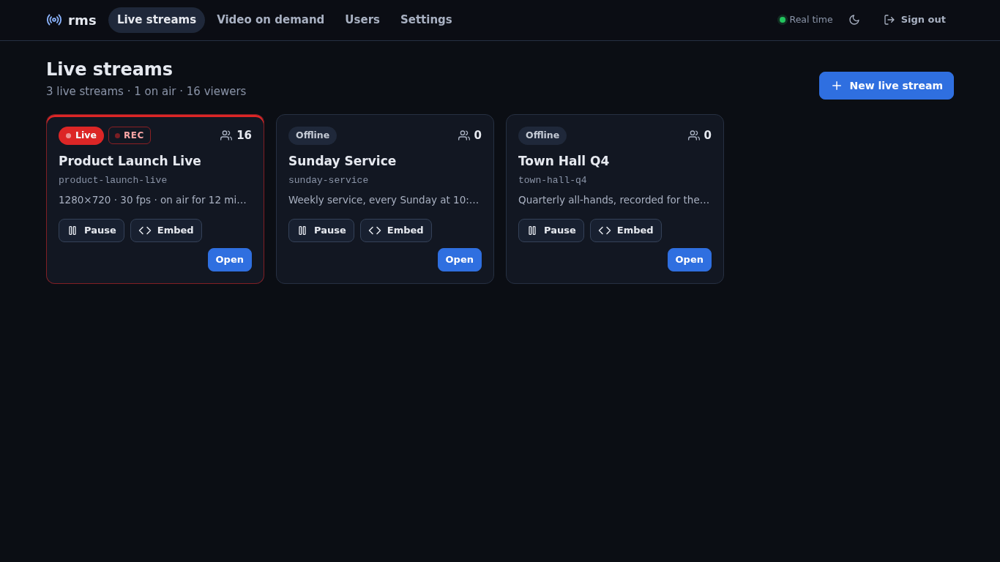](docs/screenshots/dashboard-broadcasts.png) | [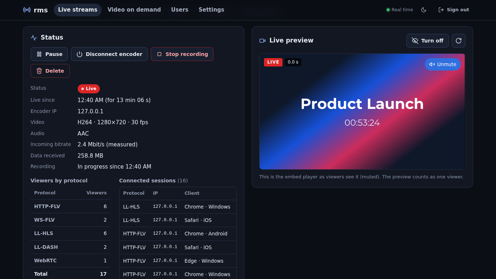](docs/screenshots/broadcast-detail.png) | [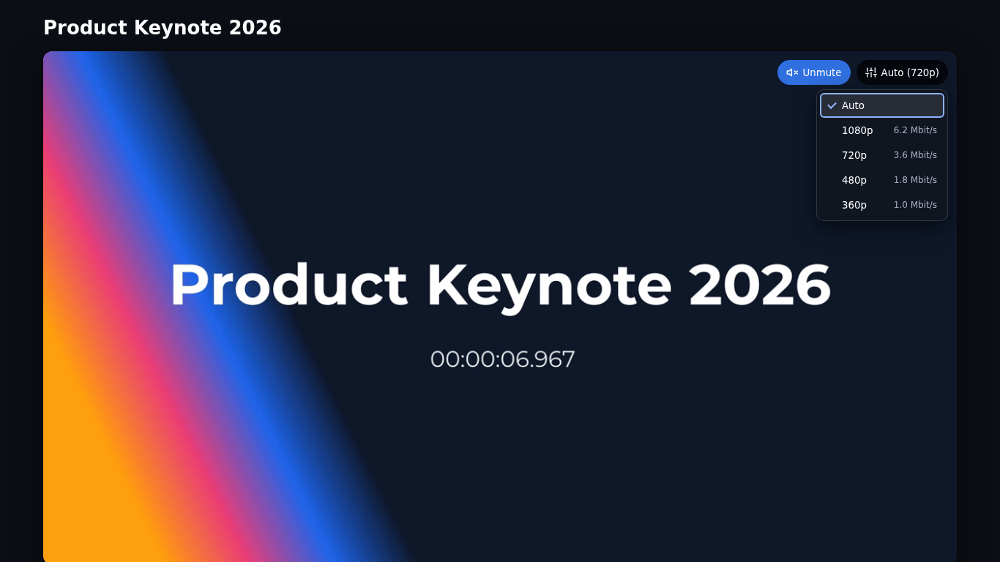](docs/screenshots/player-vod-quality.png) |

## Contents

[Features](#features) · [Quick start](#quick-start) · [Playback URLs](#playback-urls) ·
[Configuration](#configuration) · [VOD and storage API](#vod-and-storage-api) · [Deployment](#deployment) ·
[Documentation](#documentation) · [Architecture](#architecture-at-a-glance) · [Development](#development) ·
[Known limits](#known-limits-and-roadmap) · [License](#license)

## Features

**Ingest**

- RTMP from OBS Studio, ffmpeg or any RTMP encoder, with a secret stream key per live stream (regenerable,
  the encoder can be disconnected from the dashboard).
- H.264 + AAC on every output; HEVC/AV1 over Enhanced RTMP are accepted and passed through on the FLV paths.
- The dashboard measures the encoder's keyframe interval and warns when it is too long for low latency.

**Low-latency delivery**

| Protocol | Player | Measured latency |
|---|---|---|
| WebRTC (WHEP) | built-in client, no library; any WHEP client | ≈ 40 ms glass-to-glass (p50 35–40 ms) |
| HTTP-FLV / WebSocket-FLV | mpegts.js, VLC, ffplay | ≈ 0.3–1.4 s |
| LL-HLS (CMAF, parts, blocking reload) | hls.js, Safari/iOS native | ≈ 1.8 s with hls.js |
| LL-DASH (CMAF, chunked transfer) | dash.js | ≈ 2.1 s with dash.js |

Figures measured on localhost with the built-in player and a 720p30 stream with a 2 s GOP: the HTTP figures
are the player's distance from the live edge, the WebRTC one is glass-to-glass (wall clock burned into the
frame). The embed player picks the best source by itself (WebRTC → HTTP-FLV → LL-HLS → LL-DASH; on iOS
WebRTC → LL-HLS → LL-DASH) and fails over automatically, e.g. when UDP is blocked. WebRTC uses **one UDP
port** for every viewer; H.264 is passed through untouched and AAC is transcoded to Opus with ffmpeg.

**Management dashboard**

- Live streams with status, codec, resolution, bitrate and viewers in real time (SSE), pause/resume (viewers
  see the waiting video), disconnect, delete.
- OBS settings with copy buttons and x264/NVENC recommendations, ready-to-paste `<iframe>` with options,
  hls.js / mpegts.js / dash.js / WHEP snippets, live preview.

**Metrics** — concurrent viewers per protocol sampled every 5 s (90 days retention), Chart.js charts for
1 h / 6 h / 24 h / 7 d or a custom range, peak, sessions, average watch time, data received, connected
sessions with IP and client.

**Recording** — automatic (per live stream) or manual start/stop while live; FLV written in pure Rust and
remuxed to MP4 with ffmpeg; play, download and delete from the dashboard.

**Waiting video** — per live stream or a global default (any common format, normalized to H.264/AAC by
ffmpeg), looped by the player while the stream is offline or paused, with a custom text; the player switches
to the live stream as soon as it arrives.

**VOD and multi-bitrate**

- Upload from the dashboard or drop files into an **inbox folder**; one ffmpeg pass produces every quality of
  a ladder (`standard`: 1080p/720p/480p/360p, `mobile`, `single`, or your own), packaged as CMAF for both HLS
  and DASH.
- Player with automatic quality and a manual quality menu, public watch page and catalogue, re-encode, source
  download; hardware encoders (NVENC, QSV, VAAPI) can be configured.

**Users, API keys and buckets**

- The administrator creates users with quotas; users get their own **buckets** (folder trees of original
  files) and a web portal.
- **Storage API** in the style of bunny.net: `PUT`/`GET`/`DELETE` on `/storage/<bucket>/<path>` with an
  `AccessKey` header, keys scoped per bucket and path prefix (read/write/admin), optional SHA-256 checksum.
- Uploaded videos are encoded automatically; private videos play only with **signed URLs** (HMAC, expiry,
  rotatable signing key).

**i18n and themes** — dashboard and player in English or Italian, dark, light or system theme; a single embed
can force them with `?lang=` and `?theme=`.

**Deployment** — a single binary with the web UI and SQLite embedded, `ffmpeg` optional;
systemd unit, Dockerfile and compose files, Nginx Proxy Manager / nginx / Caddy guides, **cluster mode**
(PostgreSQL, origin → edge relays, HAProxy), `/healthz` for load balancers.

<details>
<summary>More screenshots</summary>

| | |
|---|---|
| 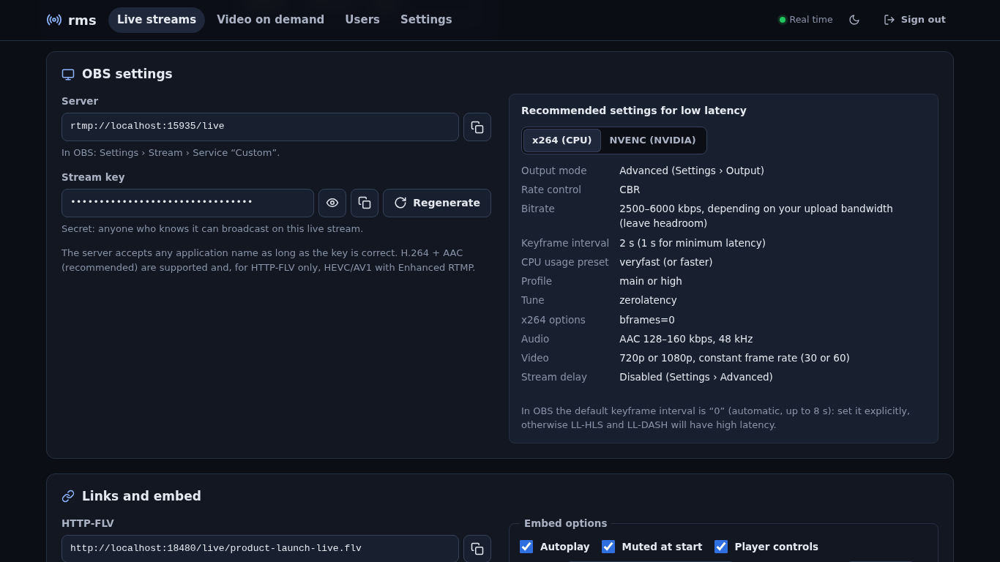 OBS settings | 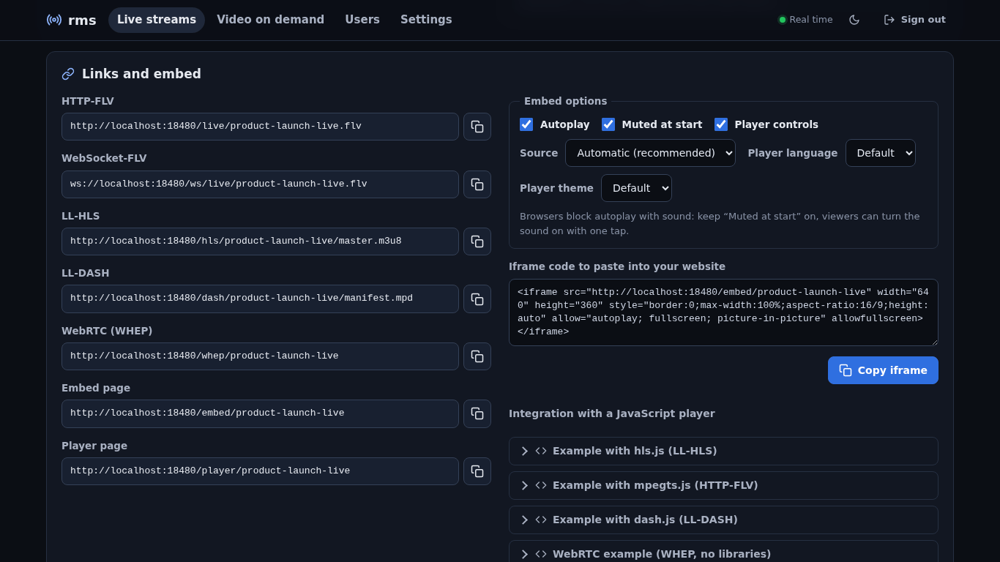 Links and embed |
|  Metrics | 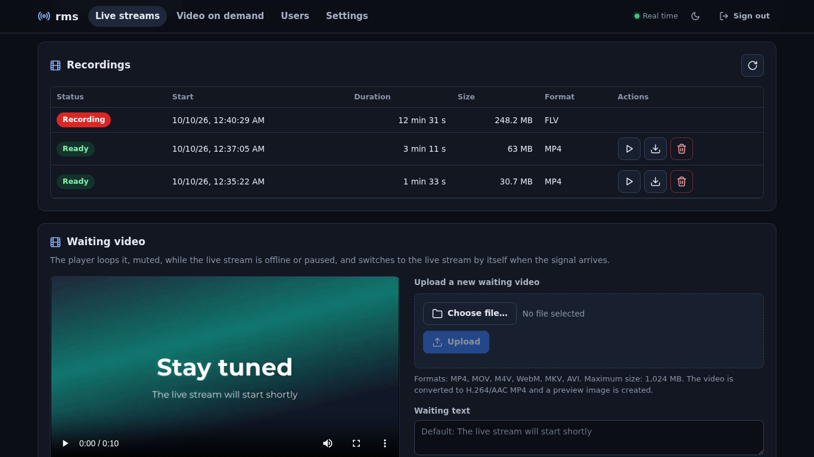 Recordings |
| 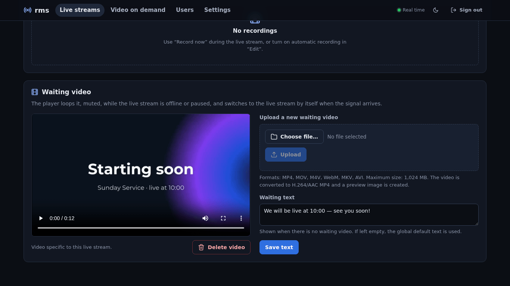 Waiting video | 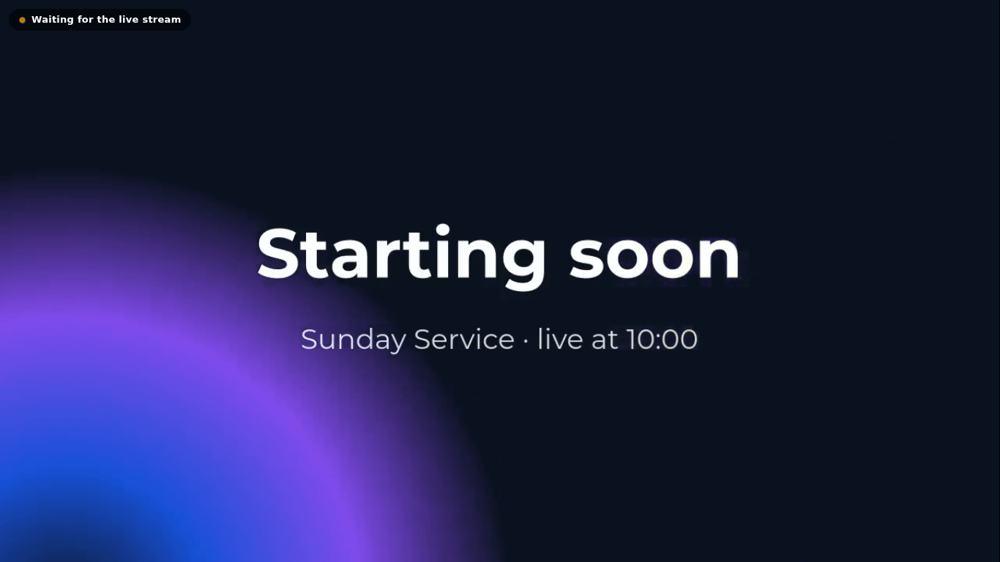 Player while offline |
| 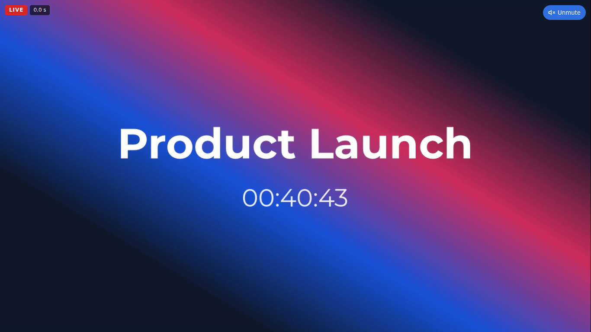 Live player (`?latency=1`) | 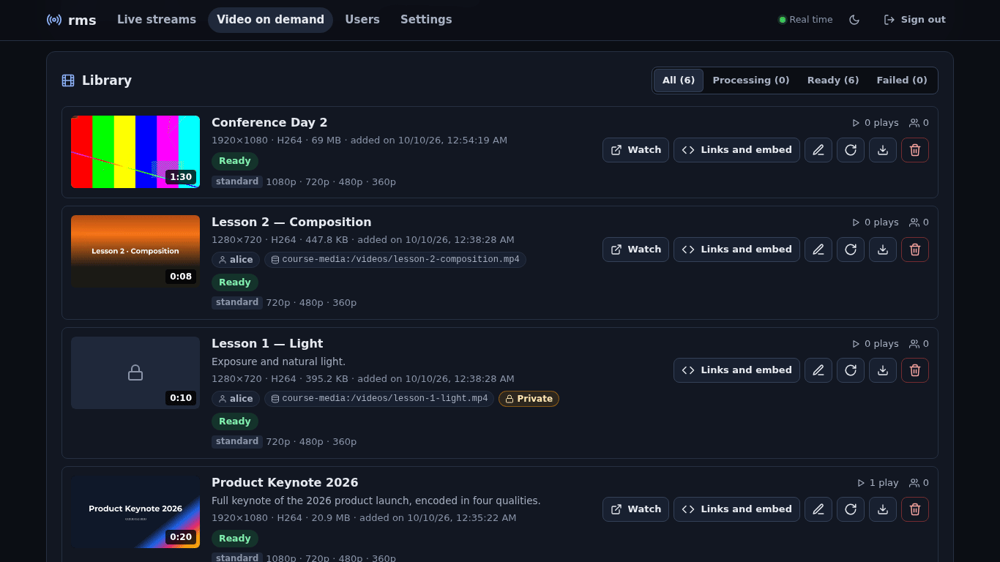 VOD library |
| 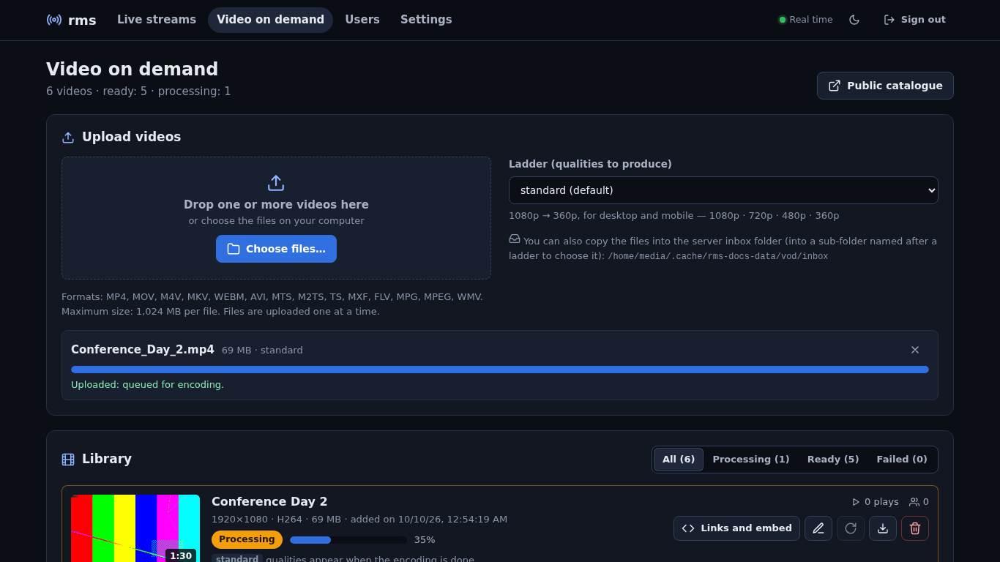 VOD upload | 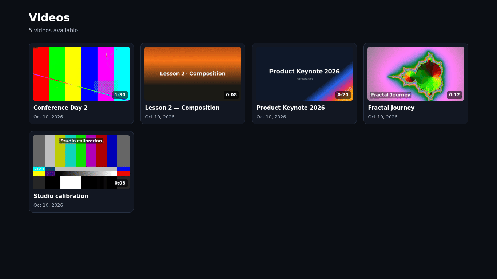 Public catalogue |
| 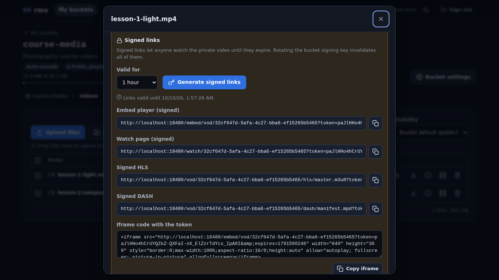 Bucket file and signed links | 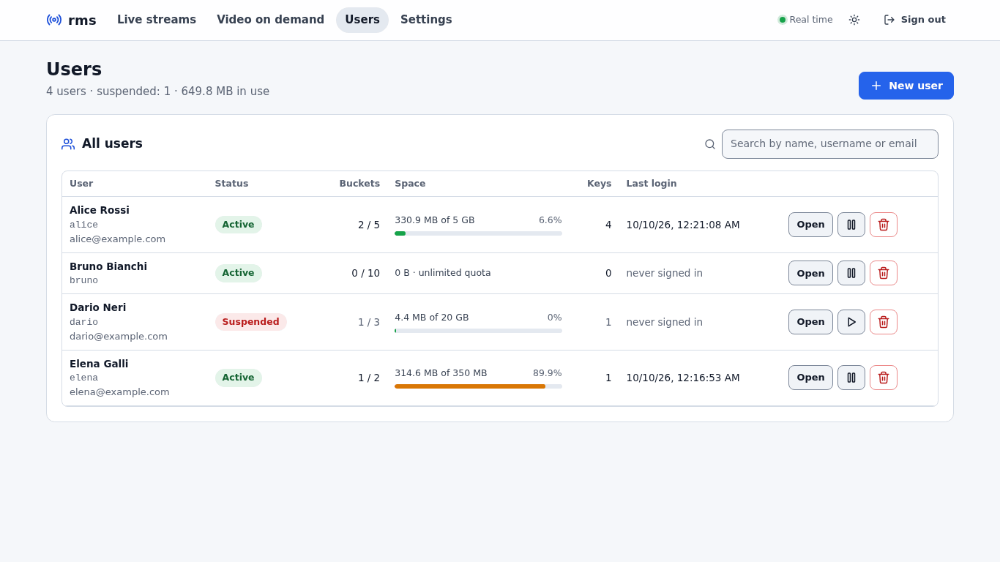 Users (light theme) |
| 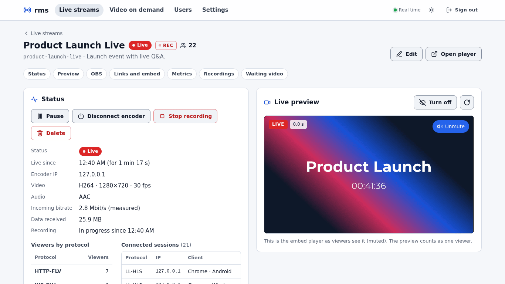 Light theme | 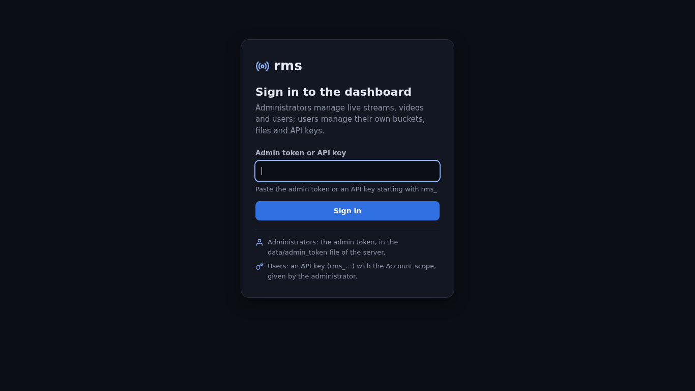 Sign in |

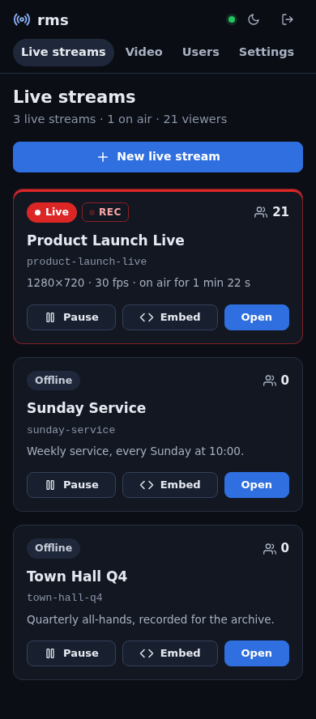

</details>

## Quick start

### Requirements

- Linux x86_64 (tested on AlmaLinux 9). Rust stable with edition 2024 to build (≥ 1.89; developed with 1.99).
- `ffmpeg` and `ffprobe` in `PATH` (optional but recommended; static builds are fine): MP4 remux of recordings,
  waiting-video normalization, Opus audio for WebRTC, and required for VOD.
- Ports: `8080/tcp` (HTTP: dashboard, API, players, FLV/HLS/DASH), `1935/tcp` (RTMP) and `8443/udp`
  (WebRTC: **one UDP port** for all viewers, open it in the firewall). All configurable.

### Build and run

```bash
git clone <repository-url> rust-media-server
cd rust-media-server
cargo build --release
./target/release/rms --data-dir ./data
```

On the first start rms generates an **admin token**, prints it in the log (`generated a new admin token: …`)
and stores it in `data/admin_token` (mode 0600). Set `RMS_ADMIN_TOKEN` or `server.admin_token` to choose
your own. Open `http://<host>:8080/`, paste the token and create a **live stream** (the URL name is derived
from the title). The dashboard language and theme are under *Settings → Language and theme*.

### OBS

*Settings → Stream → Service: Custom*, then copy the values from the *OBS settings* panel of the live stream:

| OBS setting | Value |
|---|---|
| Server | `rtmp://<host>:1935/live` |
| Stream key | the live stream's secret key |
| Output mode | Advanced (*Settings → Output*) |
| Rate control / bitrate | CBR, 2500–6000 kbps |
| Keyframe interval | **2 s** (1 s for minimum latency) — OBS's default "0" (auto) gives long GOPs |
| x264 | preset *veryfast*, tune *zerolatency* (no B-frames) |
| NVENC / QSV | tuning *Low latency* or *Ultra low latency*, multipass off, **B-frames = 0** |
| Audio | AAC 128–160 kbps, 48 kHz |

B-frames must be off for WebRTC (H.264 is passed through and browsers do not reorder B-frames). A new WebRTC
viewer starts at the next keyframe. Details: [docs/PROTOCOLS.md](docs/PROTOCOLS.md) §5 and the
[OBS setup wiki page](docs/wiki/OBS-Setup.md).

### Embed

Copy the `<iframe>` from *Links and embed*; for example:

```html
<iframe src="https://stream.example.com/embed/product-launch?autoplay=1&muted=1"
        width="960" height="540" frameborder="0"
        allow="autoplay; fullscreen; picture-in-picture" allowfullscreen></iframe>
```

The player shows the waiting video until the stream starts, when it drops or while it is paused.

### Try it without OBS

```bash
# terminal 1
./target/release/rms --data-dir /var/tmp/rms-data --http-bind 127.0.0.1:8080 --rtmp-bind 127.0.0.1:1935
# terminal 2: create a live stream and publish an ffmpeg test pattern (720p30 H.264 + AAC, 2 s GOP)
TOKEN=$(cat /var/tmp/rms-data/admin_token)
curl -s -H "Authorization: Bearer $TOKEN" -H 'Content-Type: application/json' \
     -d '{"title":"Test"}' http://127.0.0.1:8080/api/v1/broadcasts          # → "name":"test", "stream_key":"…"
scripts/test-publish.sh <stream_key> 127.0.0.1:1935
# terminal 3: check
DATA_DIR=/var/tmp/rms-data scripts/smoke.sh http://127.0.0.1:8080
ffprobe http://127.0.0.1:8080/live/test.flv
# open http://127.0.0.1:8080/player/test (add ?src=webrtc to force WebRTC; UDP port 8443 must be free)
```

## Playback URLs

Live stream `<name>` (shown in the dashboard with copy buttons):

| Protocol | URL | Players |
|---|---|---|
| WebRTC (WHEP) | `http://<host>:8080/whep/<name>` (POST of the SDP offer; media on `8443/udp`) | embed player, dashboard WHEP snippet, any WHEP client (e.g. GStreamer `whepsrc`) |
| HTTP-FLV | `http://<host>:8080/live/<name>.flv` | mpegts.js, VLC, ffplay |
| WebSocket-FLV | `ws://<host>:8080/ws/live/<name>.flv` | mpegts.js |
| LL-HLS | `http://<host>:8080/hls/<name>/master.m3u8` | hls.js, Safari/iOS, VLC |
| LL-DASH | `http://<host>:8080/dash/<name>/manifest.mpd` | dash.js |
| Embed player | `http://<host>:8080/embed/<name>` | `<iframe>` |
| Full-page player | `http://<host>:8080/player/<name>` | browser |

Embed parameters (all optional): `autoplay=1|0`, `muted=1|0`, `controls=1|0` (defaults `1`),
`src=auto|webrtc|flv|hls|dash`, `latency=1|0` (`0` on `/embed`, `1` on `/player`), `lang=it|en`,
`theme=system|light|dark` (defaults: the dashboard settings).

Video on demand `<id>`:

| What | URL |
|---|---|
| HLS / DASH | `http://<host>:8080/vod/<id>/hls/master.m3u8` · `http://<host>:8080/vod/<id>/dash/manifest.mpd` |
| Poster | `http://<host>:8080/vod/<id>/poster.jpg` |
| Embed player / watch page | `http://<host>:8080/embed/vod/<id>` · `http://<host>:8080/watch/<id>` |
| Public catalogue | `http://<host>:8080/vod` |

VOD player parameters: `autoplay`, `muted`, `controls`, `t=<seconds>` (start position), `src=auto|hls|dash`,
`lang`, `theme`, and `token` + `expires` for private videos. All parameters:
[Playback and embedding](docs/wiki/Playback-and-Embedding.md), [docs/API.md](docs/API.md) §6–§7.

## Configuration

Copy [`config.example.toml`](config.example.toml) to `config.toml` (read from the working directory) or pass
`--config <file>`. Every key is optional. Precedence: defaults < file < environment variables
`RMS_<SECTION>_<KEY>` (e.g. `RMS_SERVER_PUBLIC_URL`, `RMS_WEBRTC_PUBLIC_IP`; `RMS_ADMIN_TOKEN` for the admin
token) < CLI flags (`--data-dir`, `--http-bind`, `--rtmp-bind`).

| Key | Default | Notes |
|---|---|---|
| `server.http_bind` | `0.0.0.0:8080` | dashboard, API, players, FLV/HLS/DASH |
| `server.public_url` | empty | public URL used in links and embeds (e.g. `https://stream.example.com`); empty = from the `Host` header |
| `server.trust_proxy` | `false` | behind a reverse proxy: viewer IP from `X-Real-IP`, else the **last** `X-Forwarded-For` element |
| `server.admin_token` | empty | empty = generated at first start into `data/admin_token` |
| `server.max_upload_mb` | `1024` | waiting-video and dashboard VOD uploads |
| `rtmp.bind` | `0.0.0.0:1935` | RTMP for OBS |
| `hls.part_duration` | `0.5` | LL-HLS part duration (s) |
| `recording.remux_to_mp4` | `true` | FLV → MP4 with ffmpeg |
| `metrics.sample_interval_secs` / `retention_days` | `5` / `90` | viewer sampling and retention |
| `webrtc.udp_port` | `8443` | the single UDP port of every WebRTC session: open it, it is not proxied |
| `webrtc.public_ip` | `[]` | public IPv4 advertised to browsers; **set it behind NAT** (e.g. `["203.0.113.7"]`) |
| `webrtc.public_port` | `0` | advertised port when NAT maps another one; `0` = `udp_port` |
| `vod.encoder` / `vod.preset` | `libx264` / `veryfast` | or `h264_nvenc`, `h264_qsv`, `h264_vaapi` |
| `vod.ladders` | `standard`, `mobile`, `single` | `[[vod.ladders]]` with `{ name, height, video_kbps, audio_kbps }` renditions |
| `vod.inbox_dir` | `data/vod/inbox` | watched folder; `inbox/<ladder>/` selects the ladder |
| `storage.max_object_mb` / `storage.root` | `20480` / `data/buckets` | storage API limits and location |
| `cluster.enabled` | `false` | cluster mode (PostgreSQL), see [Cluster mode](docs/wiki/Cluster-Mode.md) |

Full reference: [Configuration wiki page](docs/wiki/Configuration.md) and the comments in
[`config.example.toml`](config.example.toml).

## VOD and storage API

Upload a video to the admin library (one ffmpeg pass, every quality of the ladder):

```bash
curl -s -H "Authorization: Bearer $TOKEN" -F file=@keynote.mp4 -F ladder=standard -F "title=Keynote" \
     http://127.0.0.1:8080/api/v1/vod
```

or copy it into `data/vod/inbox/` (`inbox/mobile/clip.mp4` uses the `mobile` ladder). Users and buckets:

```bash
B=http://127.0.0.1:8080; H="Authorization: Bearer $TOKEN"; J='Content-Type: application/json'
# admin: a user and a key with the account scope (the full key is shown only once)
curl -s -H "$H" -H "$J" -d '{"username":"alice","display_name":"Alice","quota_bytes":10737418240}' $B/api/v1/users
KEY=$(curl -s -H "$H" -H "$J" -d '{"name":"portal","scopes":["account"]}' $B/api/v1/users/alice/keys | jq -r .key)
# alice: a bucket and an upload-only key limited to /videos/
curl -s -H "AccessKey: $KEY" -H "$J" -d '{"name":"course-media"}' $B/api/v1/account/buckets
UP=$(curl -s -H "AccessKey: $KEY" -H "$J" -d '{"name":"uploader","scopes":["storage"],
  "permissions":[{"bucket":"course-media","prefix":"/videos/","access":"write"}]}' $B/api/v1/account/keys | jq -r .key)

curl -s -H "AccessKey: $UP" -H 'X-Rms-Visibility: private' -T lesson1.mp4 \
     $B/storage/course-media/videos/lesson1.mp4                   # 201, encoding queued
curl -s -H "AccessKey: $UP" $B/storage/course-media/videos/      # JSON listing with encoding status
curl -s -H "AccessKey: $UP" -T notes.txt $B/storage/course-media/other/notes.txt   # 403: outside /videos/
curl -s -H "AccessKey: $UP" -X POST -H "$J" -d '{"expires_secs":86400}' \
     "$B/storage/course-media/videos/lesson1.mp4?action=sign" | jq -r .embed       # signed player URL
```

Users can also sign in to the dashboard with their `account` key: bucket browser with drag-and-drop uploads,
encoding progress, links and signed URLs, API keys and usage. Walkthrough:
[Users, API keys and buckets](docs/wiki/Users-API-Keys-and-Buckets.md); contract:
[docs/ACCOUNTS.md](docs/ACCOUNTS.md) and [docs/API.md §9](docs/API.md#9-accounts-api-keys-and-the-storage-api).

## Deployment

- **systemd**: [`deploy/rms.service`](deploy/rms.service) (install steps in the file header).
- **Docker**: `docker build -t rms:latest .` then `docker compose up -d` with
  [`docker-compose.yml`](docker-compose.yml) (single node: ports 8080, 1935, 8443/udp, volume `rms-data`).
  The image bundles a static ffmpeg. See [Docker](docs/wiki/Docker.md).
- **Reverse proxy**: put TLS in front of `:8080` with buffering off and WebSockets on —
  [Nginx Proxy Manager guide](deploy/nginx-proxy-manager.md) (Italian; English summary in
  [the wiki](docs/wiki/Nginx-Proxy-Manager.md)), [`deploy/nginx.conf.example`](deploy/nginx.conf.example),
  [`deploy/Caddyfile.example`](deploy/Caddyfile.example). Set `server.public_url` and `server.trust_proxy = true`.
  RTMP (`1935/tcp`) and WebRTC (`8443/udp`) are exposed directly, not through the HTTP proxy.
- **Cluster mode**: several nodes sharing PostgreSQL behind HAProxy —
  [`docker-compose.cluster.yml`](docker-compose.cluster.yml), [`deploy/haproxy.cfg`](deploy/haproxy.cfg),
  [Cluster mode](docs/wiki/Cluster-Mode.md), [docs/CLUSTER.md](docs/CLUSTER.md).
- **Health check**: `GET /healthz` answers `200` with `{"node_id","cluster","db","live_streams","version","draining"}`
  while the node serves, `503` while it shuts down or drains.

## Documentation

| Document | Content |
|---|---|
| [docs/wiki/](docs/wiki/Home.md) | User guide (English): installation, configuration, OBS, playback, recording, metrics, VOD, users and buckets, cluster, Docker, NPM, troubleshooting |
| [docs/API.md](docs/API.md) | HTTP API reference: admin, public, playback endpoints, pages, storage API, curl cookbook |
| [docs/ARCHITECTURE.md](docs/ARCHITECTURE.md) | Architecture and implementation contract, as-built notes and measurements per phase |
| [docs/ACCOUNTS.md](docs/ACCOUNTS.md) | Users, API keys, buckets, storage API and signed URLs (design contract) |
| [docs/PROTOCOLS.md](docs/PROTOCOLS.md) | Low-latency protocols, OBS settings, reverse proxies, latency measurement (Italian) |
| [docs/CLUSTER.md](docs/CLUSTER.md) | Multi-instance study and cluster architecture (Italian) |
| [deploy/nginx-proxy-manager.md](deploy/nginx-proxy-manager.md) | Nginx Proxy Manager step by step, cluster behind NPM (Italian) |
| [README.it.md](README.it.md) | This guide in Italian |
| [docs/screenshots/](docs/screenshots/) | Screenshots of the dashboard and the players |

## Architecture at a glance

```
                    +---------------------- rms (single process) ----------------------+
OBS / ffmpeg --RTMP-+--> ingest ---+                                                   |
  1935/tcp          |              +--> hub: per-stream channel + GOP cache            |
other node --FLV----+--> relay ----+       |                                           |
  (cluster, :8081)  |                      +--> HTTP-FLV / WS-FLV ---------------------+--> mpegts.js, VLC
                    |                      +--> CMAF packager --> LL-HLS / LL-DASH ----+--> hls.js, Safari, dash.js
                    |                      +--> WHEP: H.264 RTP + Opus (ffmpeg) -------+--> browsers (8443/udp)
                    |                      +--> recorder: FLV --> MP4 (ffmpeg)         |
                    |                      +--> viewer tracker --> metrics             |
                    | VOD: upload / inbox / storage API --> ffmpeg ladder --> CMAF ----+--> VOD player, catalogue
                    | axum: dashboard, REST + SSE API, players; SQLite or PostgreSQL   |
                    +------------------------------------------------------------------+

Cluster:  NPM (TLS) --> HAProxy :8080 --> rms1 | rms2 | ...  <--> PostgreSQL (state, LISTEN/NOTIFY)
          OBS --> HAProxy :1935 --> any node (it owns the stream); other nodes relay it on demand
```

The publisher's node owns the stream; viewers on other nodes are served through an on-demand HTTP-FLV relay
on the internal network (measured added delay < 1 ms on a LAN). Details: [docs/ARCHITECTURE.md](docs/ARCHITECTURE.md).

## Development

```bash
cargo build --release                         # target/release/rms
cargo test                                    # unit and integration tests (SQLite)
RMS_TEST_DATABASE_URL=postgres://rms:pw@127.0.0.1:5432/rms_test cargo test   # also the PostgreSQL variants
cargo clippy --all-targets
scripts/smoke.sh http://127.0.0.1:8080 "$TOKEN"   # curl smoke test of the HTTP surface
scripts/test-publish.sh <stream_key> [host[:port]] # ffmpeg test pattern publisher (DURATION=<s> to stop)
```

`scripts/lowlatency-test.html` is a standalone LL-HLS / LL-DASH test page exposing `window.stats`.
The frontend has no build step: static files in `src/web/static/` are embedded in the binary and the player
libraries are loaded from jsDelivr/cdnjs with pinned versions.

```
src/main.rs         startup and wiring          src/hub/        stream registry, GOP cache, FLV helpers
src/ingest/         RTMP ingest (rtmp-rs)       src/egress/     HTTP-FLV, WS-FLV, LL-HLS, LL-DASH routes
src/packager/       CMAF muxer, segment store, HLS playlists, DASH MPD
src/webrtc/         WHEP: shared UDP port, sessions (rtc), H.264 → RTP, AAC → Opus (ffmpeg)
src/recorder/       FLV writer, MP4 remux       src/metrics/    viewer tracker, sampler, queries
src/api/            REST + SSE (axum)           src/web/        dashboard and players (embedded static files)
src/vod/            VOD: probe, ladders, one-pass ffmpeg, HLS/DASH post-processing, jobs, inbox, serving
src/storage/        buckets: storage API, path rules, signed URLs
src/db/             SQLite (rusqlite) or PostgreSQL (sqlx)    src/cluster/  nodes, ownership, NOTIFY bus, relay
docs/               architecture, API, protocols, cluster, accounts, wiki, screenshots
deploy/             systemd unit, HAProxy, nginx, Caddy, Nginx Proxy Manager guide
```

## Known limits and roadmap

- The LL-HLS/LL-DASH packager handles **H.264 + AAC** only; HEVC/AV1 (Enhanced RTMP) play only over HTTP-FLV/WS-FLV.
- WebRTC: H.264 without B-frames only, IPv4 only, host candidates only (**no TURN**, no trickle ICE): viewers need
  UDP reachability of `webrtc.udp_port`, otherwise the player falls back to FLV/HLS; a new viewer waits for the
  next keyframe; without ffmpeg sessions are video-only.
- No live transcoding/ABR: live quality is what the encoder sends (ABR is available for VOD).
- VOD: H.264 only; hardware encoders are wired but untested here; no thumbnail track, subtitles or
  multi-language audio.
- Cluster mode: LL-HLS/LL-DASH timelines are per node (the load balancer needs per-IP affinity; after a failover
  the player restarts); a stream fails over after `cluster.node_ttl_secs`; bucket files need a shared
  `storage.root`.
- Storage API: listings are not paginated; quotas are checked at upload time; no resumable uploads.
- Not verified in this environment: native Safari LL-HLS, HTTP/2 end to end.
- Roadmap: SRT and WHIP ingest, viewer tokens for live streams, TURN/IPv6 for WebRTC, delta playlists.

More: [docs/ARCHITECTURE.md](docs/ARCHITECTURE.md) §15 and the "Known limits" of §16–§23.

## License

[MIT](LICENSE) © 2026 Alain Martini.

Built with Rust, [tokio](https://tokio.rs/), [axum](https://github.com/tokio-rs/axum),
[rtmp-rs](https://github.com/torresjeff/rtmp-rs), [rtc](https://github.com/webrtc-rs/rtc) (webrtc-rs),
[rusqlite](https://github.com/rusqlite/rusqlite) and [sqlx](https://github.com/launchbadge/sqlx); in the browser
[hls.js](https://github.com/video-dev/hls.js), [mpegts.js](https://github.com/xqq/mpegts.js),
[dash.js](https://github.com/Dash-Industry-Forum/dash.js) and [Chart.js](https://www.chartjs.org/);
media processing by [FFmpeg](https://ffmpeg.org/).
