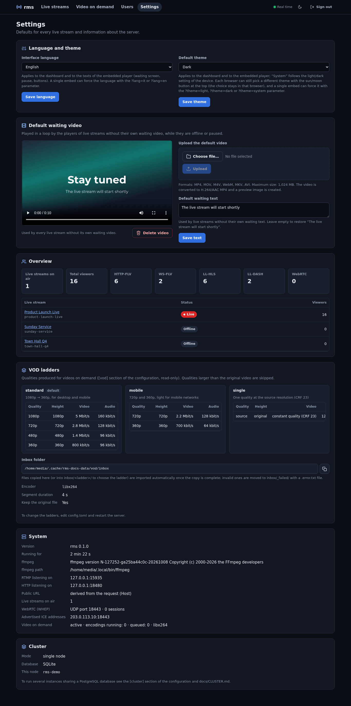

# Configuration

Every setting has a default: rms runs without a configuration file. To change something, copy
[`config.example.toml`](../../config.example.toml) to `config.toml` in the working directory (read
automatically) or pass `--config <file>`.

## Precedence

```
defaults  <  config file  <  environment variables RMS_<SECTION>_<KEY>  <  CLI flags
```

- Environment variables: the section and the key in upper case, e.g. `RMS_SERVER_PUBLIC_URL`,
  `RMS_SERVER_TRUST_PROXY=true`, `RMS_WEBRTC_UDP_PORT=8443`, `RMS_WEBRTC_PUBLIC_IP=203.0.113.7`,
  `RMS_CLUSTER_NODE_ID=rms1`. The admin token is `RMS_ADMIN_TOKEN`.
- CLI flags: `--data-dir`, `--http-bind`, `--rtmp-bind` (and `--config`).
- `RUST_LOG` overrides `log.level`.
- Changes need a restart. Runtime preferences (UI language and theme, default waiting video and text) are
  stored in the database and edited in the dashboard under *Settings*.



## `[server]`

| Key | Default | Description |
|---|---|---|
| `http_bind` | `0.0.0.0:8080` | HTTP listener: dashboard, API, players, HTTP-FLV, WS-FLV, LL-HLS, LL-DASH, WHEP signalling |
| `public_url` | `""` | public base URL used in links, embeds and OBS settings (e.g. `https://stream.example.com`); empty = derived from the request's `Host` header |
| `admin_token` | `""` | empty = generated at the first start and stored in `data/admin_token` |
| `data_dir` | `./data` | database, recordings, waiting videos, VOD, buckets, temporary uploads |
| `trust_proxy` | `false` | behind a reverse proxy: take the viewer IP from `X-Real-IP`, else from the **last** `X-Forwarded-For` element |
| `max_upload_mb` | `1024` | maximum size of dashboard uploads (waiting videos, VOD) in MiB |

## `[rtmp]`

| Key | Default | Description |
|---|---|---|
| `bind` | `0.0.0.0:1935` | RTMP listener for OBS |
| `app` | `live` | application name shown in the OBS settings (any name is accepted, the stream key decides) |
| `max_connections` | `256` | simultaneous RTMP connections |

## `[hls]` and `[dash]`

| Key | Default | Description |
|---|---|---|
| `hls.enabled` | `true` | LL-HLS packaging |
| `hls.part_duration` | `0.5` | LL-HLS part duration in seconds (`PART-HOLD-BACK` = 3 parts) |
| `hls.max_segment_duration` | `6.0` | a segment is cut at the next part when the GOP is longer than this |
| `hls.window_segments` | `6` | segments kept in the playlist |
| `hls.linger_secs` | `30` | how long the playlist stays available after the stream ends |
| `dash.enabled` | `true` | LL-DASH packaging |
| `dash.segment_duration` | `2.0` | initial segment estimate (segments follow the encoder's GOP) |

Segments follow the encoder's keyframes: set a 2 s keyframe interval in OBS ([OBS setup](OBS-Setup.md)).

## `[recording]`, `[metrics]`, `[ffmpeg]`, `[log]`

| Key | Default | Description |
|---|---|---|
| `recording.remux_to_mp4` | `true` | remux the FLV recording to MP4 (`-c copy +faststart`) when ffmpeg is available |
| `recording.keep_flv` | `false` | keep the FLV next to the MP4 |
| `metrics.sample_interval_secs` | `5` | viewer sampling interval |
| `metrics.session_timeout_secs` | `30` | an HLS/DASH viewer without requests for this long is gone |
| `metrics.retention_days` | `90` | samples and closed sessions older than this are deleted |
| `ffmpeg.path` | `""` | path of `ffmpeg`; empty = search `PATH`. `ffprobe` is taken from the same directory, else from `PATH` |
| `log.level` | `info` | `RUST_LOG` overrides it |

## `[webrtc]`

| Key | Default | Description |
|---|---|---|
| `enabled` | `true` | WebRTC egress via WHEP (`POST /whep/<name>`) |
| `udp_port` | `8443` | **one UDP port for every session** (ICE, DTLS, SRTP): open it in the firewall; it is never proxied |
| `public_port` | `0` | port advertised in the ICE candidates when NAT maps another one (e.g. public `8444` → `8443`); `0` = `udp_port` |
| `public_ip` | `[]` | IPv4 addresses advertised to browsers; empty = the local interface addresses. **Behind 1:1 NAT** (cloud VM, router port forward) put the public IP here |
| `ice_lite` | `true` | the server only answers connectivity checks |
| `max_sessions` | `100` | simultaneous WebRTC sessions (more: `503`, the player falls back to HTTP-FLV) |
| `audio_bitrate_kbps` | `96` | Opus bitrate of the AAC → Opus transcode (ffmpeg; without it sessions are video-only) |
| `idle_stop_secs` | `30` | stop a stream's WebRTC publisher after this long without WebRTC viewers |
| `stun_server` | `""` | optional STUN server advertised to clients in the WHEP `Link` header |

## `[vod]`

| Key | Default | Description |
|---|---|---|
| `enabled` | `true` | uploads, inbox and transcoding (`false`: existing videos stay playable) |
| `inbox_dir` | `""` | watched folder; empty = `<data_dir>/vod/inbox`; `inbox/<ladder>/` selects the ladder |
| `scan_interval_secs` | `10` | a file is imported when its size and mtime stay unchanged for two scans |
| `max_parallel_jobs` | `1` | concurrent ffmpeg jobs (each one encodes every rendition of its ladder) |
| `segment_duration` | `4.0` | HLS/DASH segment duration and keyframe interval (s) |
| `encoder` | `libx264` | or `h264_nvenc`, `h264_qsv`, `h264_vaapi` |
| `encoder_args` / `hwaccel_args` | `""` | extra ffmpeg arguments after the encoder / before `-i` |
| `preset` | `veryfast` | encoder preset (`p4` for NVENC, empty for VAAPI) |
| `default_ladder` | `standard` | ladder used when none is chosen |
| `keep_source` | `true` | keep the original (needed to re-encode or download it) |
| `[[vod.ladders]]` | `standard`, `mobile`, `single` | ladders: see [VOD and multi-bitrate](VOD-and-Multi-bitrate.md#ladders) |

## `[storage]`

| Key | Default | Description |
|---|---|---|
| `max_object_mb` | `20480` | largest file accepted by `PUT /storage/...` (MiB); above: `413` |
| `root` | `""` | bucket files (`<root>/<bucket id>/<path>`); empty = `<data_dir>/buckets`; shared volume in cluster mode |

## `[cluster]`

| Key | Default | Description |
|---|---|---|
| `enabled` | `false` | cluster mode: PostgreSQL instead of SQLite, relays between nodes |
| `node_id` | `""` | unique, stable id per node; empty = host name |
| `database_url` | `""` | `postgres://rms:PASSWORD@db:5432/rms` |
| `advertise_url` | `""` | internal URL of this node reachable by the others (e.g. `http://rms1:8081`) |
| `internal_bind` | `0.0.0.0:8081` | listener of `/internal/*`: never expose it publicly |
| `internal_secret` | `""` | ≥ 32 random characters, identical on every node |
| `heartbeat_secs` / `node_ttl_secs` | `5` / `15` | node registry heartbeat and expiry |
| `relay_idle_secs` | `30` | stop an edge relay this long after its last local viewer |
| `whep_url` | `""` | public WHEP base of this node (e.g. `https://rms2.example.com/whep`); empty = `<public_url>/whep` |
| `whep_redirect` | `true` | without usable WebRTC, answer `POST /whep` with `307` to another node's `whep_url` |

See [Cluster mode](Cluster-Mode.md).

## Typical setups

**Public server behind a TLS proxy**

```toml
[server]
public_url = "https://stream.example.com"
trust_proxy = true
[webrtc]
public_ip = ["203.0.113.10"]     # only behind NAT; a server with a public interface needs nothing
```

**Bigger uploads and GPU encoding**

```toml
[server]
max_upload_mb = 8192             # also raise client_max_body_size in the proxy
[vod]
encoder = "h264_nvenc"
preset = "p4"
hwaccel_args = "-hwaccel cuda"
max_parallel_jobs = 2
```

**No WebRTC** (UDP cannot be exposed): `RMS_WEBRTC_ENABLED=false`; the player uses HTTP-FLV / LL-HLS.

## Dashboard settings

*Settings* in the dashboard (stored in the database, effective immediately):

- **Language and theme** — UI language (`en`/`it`) and default theme (`system`/`light`/`dark`) of the
  dashboard and the embedded players (`PATCH /api/v1/settings {"ui_language":"en","ui_theme":"dark"}`).
  Each browser can override the theme with the sun/moon button; a single embed with `?lang=` / `?theme=`.
- **Default waiting video and text** — used by every live stream without its own.
- **Overview** — live streams on air and viewers per protocol.
- **VOD ladders** — the configured ladders, inbox folder, encoder (read-only).
- **System** — version, uptime, ffmpeg, listeners, public URL, WebRTC port and advertised ICE addresses,
  VOD queue; **Cluster** — mode, database and node.
