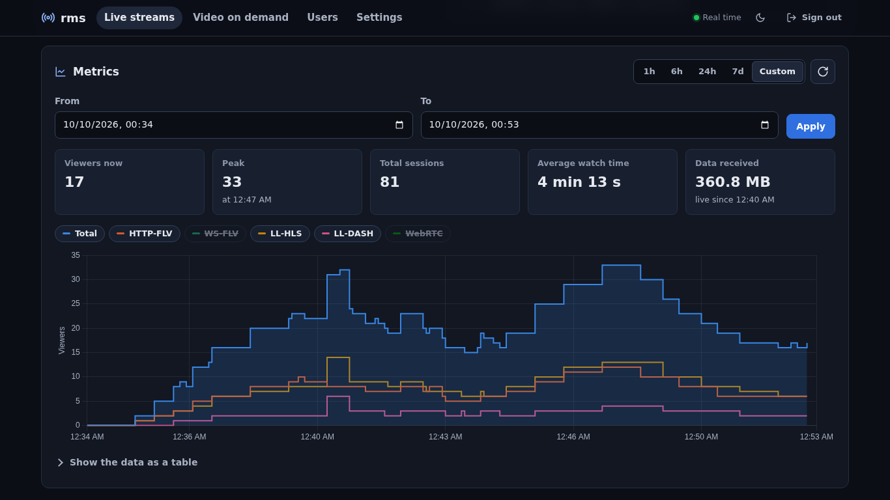

# Metrics

rms counts the viewers of every live stream per protocol, stores a time series and the individual viewing
sessions, and charts them in the dashboard.



## What is counted

| Protocol | A viewer is… |
|---|---|
| HTTP-FLV, WS-FLV | one open connection, for its whole lifetime |
| WebRTC | one connected peer connection (failed attempts are not counted) |
| LL-HLS, LL-DASH | one (IP, User-Agent) pair requesting playlists/MPDs/segments; it ends after `metrics.session_timeout_secs` (30 s) without requests |

The dashboard preview is a viewer too. Behind a reverse proxy set `server.trust_proxy = true`, otherwise every
viewer has the proxy's IP (and HLS/DASH viewers with the same browser collapse into one).

## In the dashboard

- **Status** panel: viewers now per protocol and the list of connected sessions (protocol, IP, client
  parsed from the User-Agent); the counts update in real time over SSE.
- **Metrics** panel: tiles for *viewers now*, *peak* (with its time), *total sessions*, *average watch time*
  and *data received*, and a chart of concurrent viewers per protocol (total, HTTP-FLV, WS-FLV, LL-HLS, LL-DASH,
  WebRTC; click a legend entry to hide a series). Ranges: 1 h, 6 h, 24 h, 7 d or a custom range; *Show the
  data as a table* for an accessible view.
- **Settings → Overview**: live streams on air and total viewers per protocol across the server.
- The live streams list shows the current viewers of each stream.

Samples are taken every `metrics.sample_interval_secs` (5 s) while a stream is live and kept
`metrics.retention_days` (90 days). Each chart point is the **maximum** of its time bucket; the bucket size
grows with the range (at most 600 points). In cluster mode the counts are the sum over the nodes.

## API

```bash
H="Authorization: Bearer $TOKEN"; B=http://127.0.0.1:8080/api/v1
curl -s -H "$H" $B/metrics/overview                                  # every live stream, viewers per protocol
curl -s -H "$H" $B/broadcasts/<name>/sessions                        # connected viewers (IP, user agent, start)
curl -s -H "$H" "$B/broadcasts/<name>/metrics?step=60"               # series of the last hour, 1-minute buckets
curl -s -H "$H" "$B/broadcasts/<name>/metrics?from=2026-10-01T00:00:00Z&to=2026-10-02T00:00:00Z"
curl -s -H "$H" "$B/broadcasts/<name>/metrics/summary"               # peak, sessions_total, avg_watch_secs, bytes_in
curl -N -H "$H" $B/events                                            # SSE: live status and viewer counts
```

`step` is rounded up to 5, 10, 30, 60, 300, 900, 3600, 7200, 21600 or 86400 s; ranges up to 90 days. Field
details: [docs/API.md](../API.md) §4.3 and §4.6.

## Video on demand

VOD plays are counted separately: the library shows *plays* (viewing sessions started) and *viewers now* for
each video; they are not written to the live metrics tables.
