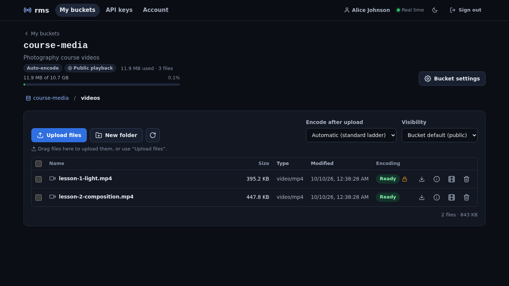

# Users, API keys and buckets

rms can host content for other people and applications, in the style of bunny.net Storage Zones + Stream:

- the **administrator** (admin token) creates **users** with a quota;
- every user owns **buckets**: folder trees of original files;
- files are uploaded with a simple **storage API** (`PUT`/`GET`/`DELETE` over HTTP) using **API keys** that can
  be limited to a bucket and a path prefix;
- uploaded videos are **encoded automatically** by the [VOD pipeline](VOD-and-Multi-bitrate.md) into HLS/DASH,
  while the original stays in the bucket;
- **private** videos play only with **signed URLs** that expire.

The full contract is in [docs/ACCOUNTS.md](../ACCOUNTS.md) and [docs/API.md §9](../API.md#9-accounts-api-keys-and-the-storage-api).

## Concepts

| Thing | Notes |
|---|---|
| User | `username` (slug, 2–32 characters), display name, e-mail, status *active*/*suspended*, quota in bytes (`0` = unlimited; originals + encodings count), max buckets (10), default ladder |
| Bucket | globally unique name used in URLs (`/storage/<bucket>/…`), description, auto-encode on/off, public or private playback, default ladder, **signing key** (rotatable) |
| API key | `rms_` + 40 hex characters, **shown once**; scopes and permissions; optional expiry; revocable |
| Scope `account` | the account API (keys, buckets, encodings, signing) and `admin` access to all the user's buckets; needed to sign in to the dashboard portal |
| Scope `storage` | the storage API only, within the key's permissions — for programs and upload scripts |
| Permission | `{"bucket": "<name or id> \| *", "prefix": "/videos/", "access": "read \| write \| admin"}` |

Access levels are ordered `read < write < admin`:

| Level | Allows |
|---|---|
| `read` | list directories, download files, `HEAD`, `?info=1`, `?action=sign` |
| `write` | + upload/overwrite files, create directories, delete files, `?action=encode` |
| `admin` | + delete directories recursively |

A permission applies when its bucket matches and the path starts with its prefix (plain string prefix: the
file path, or the directory path with its trailing `/`). `/videos/` covers `/videos/a.mp4` and the listing of
`/videos/`, not the bucket root nor `/videos-old.txt`.

## In the dashboard

**Administrator — *Users*.** List with status, buckets, usage against the quota, keys and last login;
*New user*; suspend/reactivate (keys stop working at once), delete (with a second confirmation when the user
owns buckets). The user page shows usage (*Recount* re-measures the files on disk), API keys (the full key is
shown only once), buckets (opened in the same file browser as the portal) and encodings. The *Video on
demand* library shows the owner and bucket of users' videos.


**User portal.** Users sign in on the normal login page with a key that has the **account** scope (a
storage-only key is refused: it is meant for programs).

- **My buckets** — bucket cards (space, files, auto-encode, public/private playback) and settings
  (description, ladder, signing-key rotation, delete). The **file browser** has breadcrumbs, folders,
  drag-and-drop or multi-file uploads (one streamed `PUT` per file with progress and cancel, SHA-256 checksum
  computed in the browser up to 256 MB, encoding and visibility choice), live encoding status and
  multi-select.
- **File dialog** — metadata, produced qualities, every link with a *Copy* button (direct URL, download, HLS,
  DASH, poster, player, watch page, iframe), public/private switch and, for private videos, **signed links**
  valid for 1 hour, 24 hours, 7 days or a custom time; *Play* opens the signed player.
- **API keys** — name, scopes, per-bucket permissions with prefix and level, optional expiry; edit and revoke.
- **Account** — profile, space used and quota, limits, the key in use.




## Walkthrough with curl

```bash
B=http://127.0.0.1:8080; H="Authorization: Bearer $TOKEN"; J='Content-Type: application/json'

# 1. admin: create a user (10 GiB quota) and its first key with the account scope
curl -s -H "$H" -H "$J" -d '{"username":"alice","display_name":"Alice Johnson","quota_bytes":10737418240}' \
     $B/api/v1/users
KEY=$(curl -s -H "$H" -H "$J" -d '{"name":"portal","scopes":["account"]}' $B/api/v1/users/alice/keys | jq -r .key)
curl -s -H "AccessKey: $KEY" $B/api/v1/auth/check            # {"role":"user","user":{…},"scopes":["account"],…}

# 2. alice: a bucket (private playback by default for new files) and an upload-only key for /videos/
curl -s -H "AccessKey: $KEY" -H "$J" -d '{"name":"course-media","description":"Course videos","public_playback":false}' \
     $B/api/v1/account/buckets
UP=$(curl -s -H "AccessKey: $KEY" -H "$J" -d '{"name":"uploader","scopes":["storage"],
  "permissions":[{"bucket":"course-media","prefix":"/videos/","access":"write"}]}' $B/api/v1/account/keys | jq -r .key)

# 3. storage API
curl -s -H "AccessKey: $UP" -H "Checksum: $(sha256sum lesson1.mp4 | cut -d' ' -f1)" \
     -X PUT --data-binary @lesson1.mp4 $B/storage/course-media/videos/lesson1.mp4 | jq .encoding.status   # "queued"
curl -s -H "AccessKey: $UP" -T big.mov $B/storage/course-media/videos/big.mov      # -T streams large files
curl -s -H "AccessKey: $UP" $B/storage/course-media/videos/ | jq '.[] | {name, size, status: .encoding.status}'
curl -s -H "AccessKey: $UP" -o copy.mp4 $B/storage/course-media/videos/lesson1.mp4   # the original (Range ok)
curl -s -H "AccessKey: $UP" "$B/storage/course-media/videos/lesson1.mp4?info=1" | jq .encoding
curl -s -H "AccessKey: $UP" -T notes.txt $B/storage/course-media/other/notes.txt -w ' %{http_code}\n'   # 403
curl -s -H "AccessKey: $UP" -X DELETE $B/storage/course-media/videos/big.mov -w '%{http_code}\n'        # 204

# 4. account
curl -s -H "AccessKey: $KEY" $B/api/v1/account | jq .usage
curl -N -H "AccessKey: $KEY" $B/api/v1/account/events          # SSE: encoding progress of alice's videos
```

### Storage API reference

| Request | Needs | Result |
|---|---|---|
| `GET /storage/<b>/` or `/storage/<b>/<dir>/` | read | JSON listing: `name`, `path`, `is_dir`, `size`, `content_type`, `sha256`, dates, `encoding` |
| `GET /storage/<b>/<file>` | read | the file (`Range`, `ETag`; `?download=1` = attachment); `?info=1` = JSON with encoding and playback URLs |
| `HEAD /storage/<b>/<file>` | read | metadata headers |
| `PUT /storage/<b>/<path>/<file>` | write | upload (raw body, streamed; parent folders created; overwrite allowed) → `201` |
| `PUT /storage/<b>/<dir>/` | write | create a folder → `201` |
| `DELETE /storage/<b>/<file>` | write | delete the file and its encoding → `204` |
| `DELETE /storage/<b>/<dir>/` | admin | recursive delete → `204` |
| `POST …/<file>?action=encode` `{ladder?, visibility?}` | write | (re-)queue the encoding → `202` |
| `POST …/<file>?action=sign` `{expires_secs?}` | read | signed URLs `{hls, dash, poster, embed, watch, expires, …}` |

Upload headers: `Checksum: <sha256 hex>` (verified, `400` on mismatch), `X-Rms-Encode: <ladder>` or `none`
(otherwise the bucket's auto-encode decides, for video extensions), `X-Rms-Visibility: public|private`
(default: the bucket's playback setting). Limits: `storage.max_object_mb` (20 GiB, `413`), the user quota
(`507 Insufficient Storage`). Paths are normalized (percent-decoding, Unicode NFC) and `..`, control
characters, empty segments and names starting with `.rms` are refused.

## Signed URLs

Encodings with `visibility = private` need a token signed with the bucket's `signing_key`:

```
token = base64url_nopad( HMAC-SHA256( key = signing_key (64 hex characters, as text),
                                      message = "<vod_id>|<expires>" ) )
```

Get them from the API (`?action=sign`, `?info=1` or `POST /api/v1/account/buckets/<bucket>/sign`):

```bash
curl -s -H "AccessKey: $UP" -X POST -H "$J" -d '{"expires_secs":86400}' \
     "$B/storage/course-media/videos/lesson1.mp4?action=sign" | jq -r .embed
# http://…/embed/vod/<vod_id>?token=…&expires=…
```

or sign them yourself on your backend:

```bash
EXP=$(( $(date +%s) + 3600 ))
TOKEN=$(printf '%s|%s' "$VOD_ID" "$EXP" | openssl dgst -sha256 -hmac "$SIGNING_KEY" -binary | base64 | tr '+/' '-_' | tr -d '=')
echo "$B/embed/vod/$VOD_ID?token=$TOKEN&expires=$EXP"
```

- The token is accepted on every `/vod/<id>/…` request (master, playlists, MPD, segments, poster) and on the
  public info; the first accepted request also sets a cookie scoped to `/vod/<id>/`, and private playlists and
  MPDs are rewritten with the token, so native HLS players work too.
- The embed player and the watch page forward `token`/`expires` to every request; without a valid token they
  show a "Private video" card (`401`).
- **Rotating the signing key** (bucket settings, or `POST /api/v1/account/buckets/<bucket>/rotate-signing-key`)
  invalidates every link at once (within 5 s on the other nodes of a cluster).
- Public videos ignore tokens and appear in the `/vod` catalogue; private ones never do. Admin-library videos
  are always public.

## Good practices

- Give programs **storage-only** keys limited to the folder they write (`/uploads/` with `write`), with an
  expiry when possible; keep `account` keys for people.
- Send `Checksum` on uploads from scripts; use `curl -T` (streams the file) for large files.
- Suspending a user blocks all their keys immediately; deleting a user deletes their buckets, files and
  encodings.
- In cluster mode `storage.root` must be a volume shared by every node.
- Limits: listings are not paginated, quotas are checked at upload time (parallel uploads can overshoot),
  no resumable uploads.
